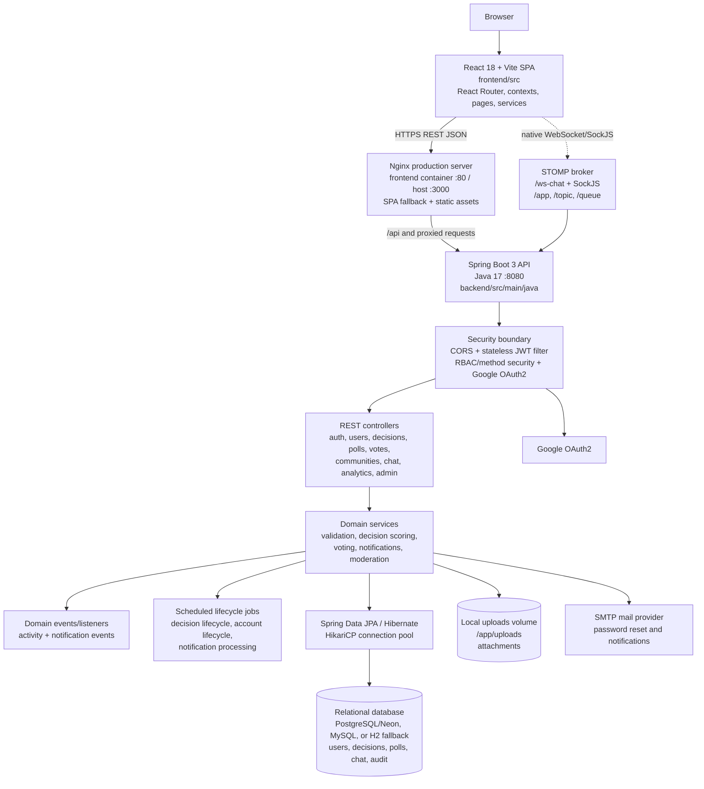
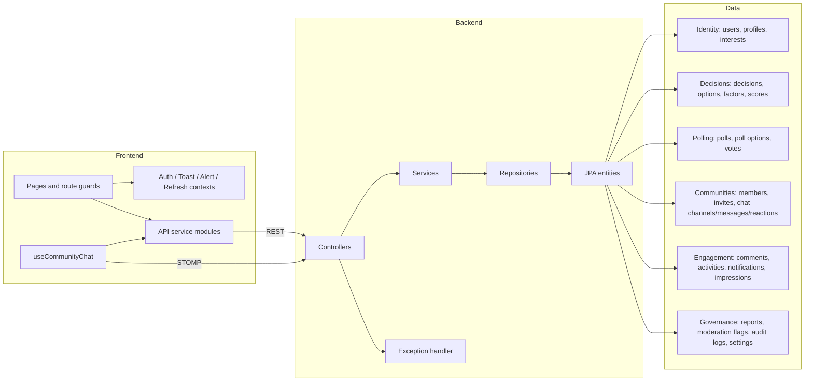
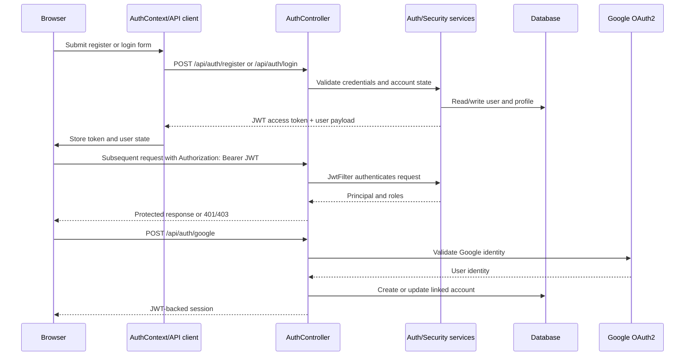
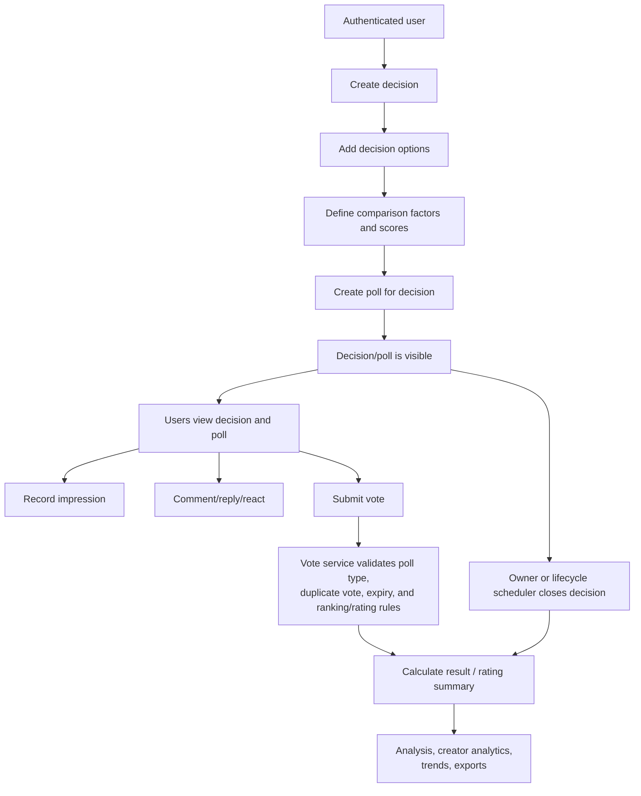
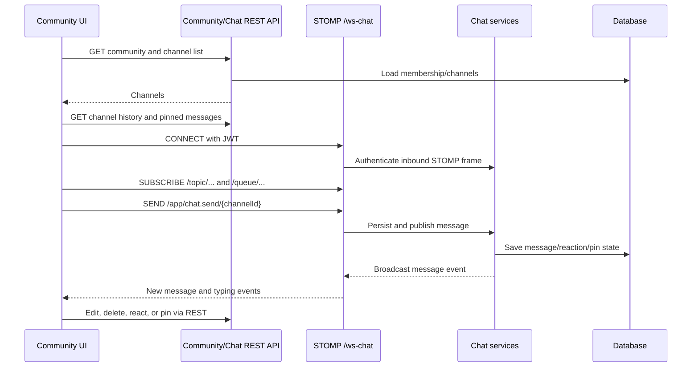
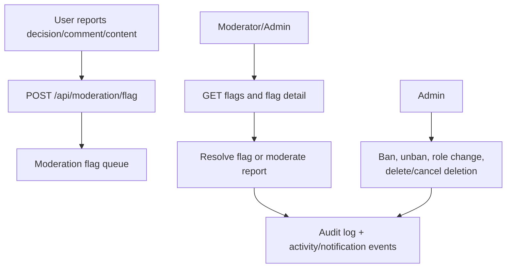
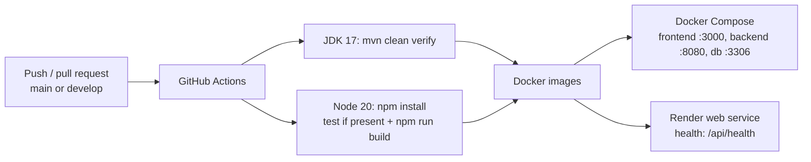
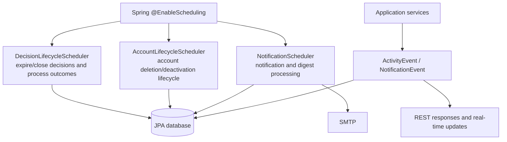

# DecisionHub Architecture

This document describes the implemented architecture, runtime flows, and HTTP/WebSocket surface of DecisionHub. It is based on the React frontend, Spring Boot controllers/configuration, persistence model, and deployment files in this repository.

## 1. System architecture

### Runtime boundaries

| Boundary | Implementation |
|---|---|
| Browser/client | React SPA, protected/admin route guards, contexts for auth/toasts/alerts/refresh |
| HTTP client | `frontend/src/api/axiosClient.js` and `frontend/src/services/api.js`; bearer token injection and 401 handling |
| API | Spring Boot application started by `DecisionHubApplication` |
| Authentication | Local register/login, stateless JWT, BCrypt-compatible password encoder, Google OAuth2 |
| Authorization | Public read endpoints plus authenticated mutations; admin/moderator checks at method/service level |
| Persistence | JPA entities/repositories with PostgreSQL, MySQL, or H2-compatible configuration |
| Real time | STOMP simple broker with `/app` destinations and `/topic`/`/queue` subscriptions |
| Files | Multipart attachment endpoints backed by the `decisionhub_uploads` volume |
| Operations | Docker Compose, Render blueprint, GitHub Actions CI |

> **Deployment note:** Docker Compose starts a MySQL container, but the backend environment defaults to a PostgreSQL/Neon JDBC URL. Set the datasource variables consistently for the selected database; otherwise the compose topology and backend dialect are mismatched.

## 2. Component and data architecture

## 3. Main workflows

### Authentication and session workflow

### Decision, evaluation, and voting workflow

### Community and real-time chat workflow

STOMP application destinations implemented by `CommunityChatWsController`:

| Destination | Purpose |
|---|---|
| `/app/chat.send/{channelId}` | Send a chat message |
| `/app/chat.typing/{channelId}` | Publish typing indicator |
| `/ws-chat` | Native WebSocket and SockJS handshake endpoint |
| `/topic/**`, `/queue/**` | Simple broker subscription destinations |

### Moderation and governance workflow

### Delivery and deployment workflow

## 4. REST endpoint inventory

All paths below are relative to the backend host, normally `http://localhost:8080`. `Public` means permitted by `SecurityConfig`; other endpoints require a valid JWT and may additionally require an owner, community role, moderator, or admin role.

### Health, authentication, taxonomy, search, and activity

| Method | Path | Access | Purpose |
|---|---|---|---|
| GET | `/`, `/health`, `/api/health` | Public | Health/readiness response |
| POST | `/api/auth/register` | Public | Register local account |
| POST | `/api/auth/login` | Public | Authenticate local account |
| POST | `/api/auth/forgot-password` | Public | Start password reset |
| POST | `/api/auth/reset-password` | Public | Consume reset token |
| PUT | `/api/auth/change-password` | Authenticated | Change password |
| POST | `/api/auth/set-password` | Authenticated | Set password for linked account |
| POST | `/api/auth/google` | Public | Authenticate/link Google account |
| GET | `/api/categories` | Public | List categories |
| GET | `/api/categories/{id}` | Public | Get category |
| POST | `/api/categories` | Authenticated/admin as enforced | Create category |
| GET | `/api/search` | Public | Search platform content |
| GET | `/api/activities/recent` | Public | Recent activity feed |
| GET | `/api/activities/communities/{communityId}` | Public | Community activity |
| GET | `/api/activities/users/{userId}` | Public | User activity |

### Users and saved decisions

| Method | Path | Purpose |
|---|---|---|
| GET | `/api/users` | List/search users |
| GET | `/api/users/{id}` | Get user |
| GET | `/api/users/me` | Get current profile |
| PUT | `/api/users/{id}` | Replace user profile |
| PATCH | `/api/users/{id}` | Partially update user profile |
| DELETE | `/api/users/{id}` | Delete/deactivate user account |
| GET | `/api/users/me/interests` | Read current interests |
| POST | `/api/users/me/interests` | Update interests |
| POST | `/api/users/me/visibility/toggle` | Toggle profile visibility |
| PUT | `/api/users/me/visibility` | Set profile visibility |
| GET | `/api/users/me/saved-decisions` | List saved decisions |
| POST | `/api/users/me/saved-decisions` | Save a decision |
| DELETE | `/api/users/me/saved-decisions/{decisionId}` | Remove saved decision |
| POST | `/api/users/me/account/deactivate` | Deactivate account |
| POST | `/api/users/me/account/reactivate` | Reactivate account |
| POST | `/api/users/me/account/delete` | Schedule account deletion |
| POST | `/api/users/me/account/delete/cancel` | Cancel scheduled deletion |
| POST | `/api/users/me/connect-google` | Connect Google identity |

### Decisions, comments, polls, votes, and recommendations

| Method | Path | Access | Purpose |
|---|---|---|---|
| GET | `/api/decisions` | Public | List visible decisions |
| GET | `/api/decisions/all` | Authenticated | List all accessible decisions |
| GET | `/api/decisions/{id}` | Public | Get decision details |
| POST | `/api/decisions` | Authenticated | Create decision |
| PUT | `/api/decisions/{id}` | Authenticated/owner | Update decision |
| DELETE | `/api/decisions/{id}` | Authenticated/owner | Delete decision |
| POST | `/api/decisions/{id}/options` | Authenticated/owner | Add option |
| DELETE | `/api/decisions/{id}/options/{optionId}` | Authenticated/owner | Remove option |
| PATCH | `/api/decisions/{id}/close` | Authenticated/owner | Close decision |
| POST | `/api/comments` | Authenticated | Add comment |
| POST | `/api/comments/{id}/reply` | Authenticated | Reply to comment |
| POST | `/api/comments/{id}/react` | Authenticated | React to comment |
| GET | `/api/comments/decision/{decisionId}` | Public | List decision comments |
| GET | `/api/comments/{id}/replies` | Public | List comment replies |
| PUT | `/api/comments/{id}` | Authenticated/owner | Edit comment |
| DELETE | `/api/comments/{id}` | Authenticated/owner/moderator | Delete comment |
| POST | `/api/polls` | Authenticated | Create poll |
| GET | `/api/polls` | Public | List polls |
| GET | `/api/polls/decision/{decisionId}` | Public | Get decision polls |
| POST | `/api/votes` | Authenticated | Cast vote |
| GET | `/api/votes/result/{pollId}` | Public | Get poll result |
| GET | `/api/votes/rating-summary/{pollId}` | Public | Get rating summary |
| POST | `/api/suggestions` | Authenticated | Create suggestion |
| GET | `/api/suggestions/decision/{decisionId}` | Public | Suggestions for decision |
| GET | `/api/suggestions` | Authenticated | Current user's suggestions |
| POST | `/api/recommendations` | Authenticated | Create recommendation |
| GET | `/api/recommendations/decision/{decisionId}` | Public | Recommendations for decision |
| GET | `/api/recommendations` | Authenticated | Current user's recommendations |

### Communities and chat

| Method | Path | Access | Purpose |
|---|---|---|---|
| POST | `/api/communities` | Authenticated | Create community |
| GET | `/api/communities` | Public | List communities |
| GET | `/api/communities/{id}` | Public | Get community |
| PUT | `/api/communities/{id}` | Authenticated/manager | Update community |
| DELETE | `/api/communities/{id}` | Authenticated/manager | Delete community |
| POST | `/api/communities/{id}/join` | Authenticated | Join community |
| POST | `/api/communities/{id}/leave` | Authenticated | Leave community |
| GET | `/api/communities/{id}/members` | Public/authenticated as enforced | List members |
| PATCH | `/api/communities/{id}/members/{userId}/role` | Community manager | Change member role |
| DELETE | `/api/communities/{id}/members/{userId}` | Community manager | Remove member |
| POST | `/api/communities/{id}/transfer-ownership` | Community owner | Transfer ownership |
| GET | `/api/communities/{id}/decisions` | Public | List community decisions |
| POST | `/api/communities/{id}/decisions` | Authenticated member | Create community decision |
| POST | `/api/communities/{id}/invite` | Authenticated member/manager | Invite user |
| GET | `/api/communities/invites/pending` | Authenticated | List pending invites |
| POST | `/api/communities/invites/{inviteId}/respond` | Authenticated | Accept/decline invite |
| GET | `/api/communities/{communityId}/chat/channels` | Authenticated/member | List chat channels |
| POST | `/api/communities/{communityId}/chat/channels` | Authenticated/manager | Create channel |
| GET | `/api/communities/{communityId}/chat/channels/{channelId}/messages` | Authenticated/member | Load channel history |
| POST | `/api/communities/{communityId}/chat/channels/{channelId}/messages` | Authenticated/member | Create message via REST |
| PUT | `/api/communities/{communityId}/chat/messages/{messageId}` | Authenticated/author | Edit message |
| DELETE | `/api/communities/{communityId}/chat/messages/{messageId}` | Authenticated/author/moderator | Delete message |
| POST | `/api/communities/{communityId}/chat/messages/{messageId}/react` | Authenticated/member | Toggle message reaction |
| PATCH | `/api/communities/{communityId}/chat/messages/{messageId}/pin` | Authenticated/manager | Pin/unpin message |
| GET | `/api/communities/{communityId}/chat/channels/{channelId}/pinned` | Authenticated/member | List pinned messages |

### Files, notifications, analytics, moderation, and administration

| Method | Path | Access | Purpose |
|---|---|---|---|
| POST | `/api/files/upload` | Authenticated | Upload attachment |
| POST | `/api/files/upload/decision/{decisionId}` | Authenticated | Attach file to decision |
| POST | `/api/files/upload/comment/{commentId}` | Authenticated | Attach file to comment |
| GET | `/api/files/{id}` | Public | Get attachment metadata/content |
| GET | `/api/files/decision/{decisionId}` | Public | List decision attachments |
| GET | `/api/files/comment/{commentId}` | Public | List comment attachments |
| GET | `/api/files/download/{filename:.+}` | Public | Download stored file |
| DELETE | `/api/files/{id}` | Authenticated/owner | Delete attachment |
| GET | `/api/notifications` | Authenticated | List notifications |
| GET | `/api/notifications/unread` | Authenticated | List unread notifications |
| GET | `/api/notifications/count` | Authenticated | Count unread notifications |
| GET | `/api/notifications/preferences` | Authenticated | Get notification preferences |
| PUT | `/api/notifications/preferences` | Authenticated | Update notification preferences |
| PUT | `/api/notifications/{id}/read` | Authenticated | Mark notification read |
| PUT | `/api/notifications/read-all` | Authenticated | Mark all notifications read |
| DELETE | `/api/notifications/{id}` | Authenticated | Delete notification |
| GET | `/api/analysis/my-votes` | Authenticated | Analyze current user's votes |
| GET | `/api/analytics/my-decisions` | Authenticated | Creator decision analytics |
| POST | `/api/decisions/{id}/impressions` | Public | Record decision impression |
| GET | `/api/analytics/trends` | Public | Platform trends |
| GET | `/api/analytics/categories` | Public | Category analytics |
| GET | `/api/analytics/communities/{id}` | Authenticated/member | Community analytics |
| GET | `/api/analytics/reports/export` | Authenticated/admin as enforced | Export analytics report |
| GET | `/api/decisions/{id}/export/csv` | Public | Export decision CSV |
| POST | `/api/moderation/flag` | Authenticated | Flag content |
| GET | `/api/moderation/flags` | Moderator/admin | List moderation flags |
| GET | `/api/moderation/flags/{id}` | Moderator/admin | Get flag |
| PUT | `/api/moderation/flags/{id}/resolve` | Moderator/admin | Resolve flag |
| GET | `/api/moderation/flags/target/{type}/{id}` | Moderator/admin | Flags for target |
| GET | `/api/admin/stats/overview` | Admin | Overview statistics |
| GET | `/api/admin/stats/timeseries` | Admin | Time-series statistics |
| POST | `/api/reports` | Authenticated | Submit report |
| GET | `/api/reports/my-submissions` | Authenticated | Current user's reports |
| GET | `/api/reports/my-notices` | Authenticated | Notices for current user |
| GET | `/api/admin/reports` | Admin/moderator | List reports |
| GET | `/api/admin/reports/{id}` | Admin/moderator | Report detail |
| POST | `/api/admin/reports/{id}/moderate` | Admin/moderator | Apply moderation action |
| PUT | `/api/reports/{id}/resolve` | Authenticated/authorized | Resolve own report |
| DELETE | `/api/reports/{id}` | Authenticated/authorized | Delete report |
| DELETE | `/api/admin/reports/{id}` | Admin/moderator | Delete report administratively |
| POST | `/api/admin/users/{id}/ban` | Admin | Ban user |
| POST | `/api/admin/users/{id}/unban` | Admin | Unban user |
| DELETE | `/api/admin/users/{id}/permanent` | Admin | Permanently delete user |
| POST | `/api/admin/users/{id}/cancel-deletion` | Admin | Cancel user deletion |
| PUT | `/api/admin/users/{id}/role` | Admin | Change user role |
| GET | `/api/admin/audit-logs` | Admin | Read audit logs |
| GET | `/api/admin/settings` | Admin | Read admin settings |
| PUT | `/api/admin/settings` | Admin | Update admin settings |

## 5. Background processing and integrations

The database model is organized around users and profiles; decisions and options; comparison factors and scores; polls and votes; communities and membership; chat channels/messages/reactions; comments and attachments; activity, notifications, impressions; and moderation/audit records. Flyway scripts exist for schema evolution, while the active application configuration currently disables Flyway and relies on Hibernate `ddl-auto` unless deployment overrides those settings.

